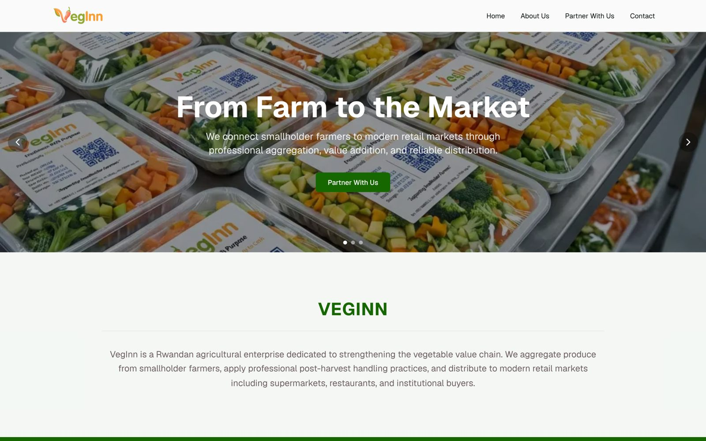
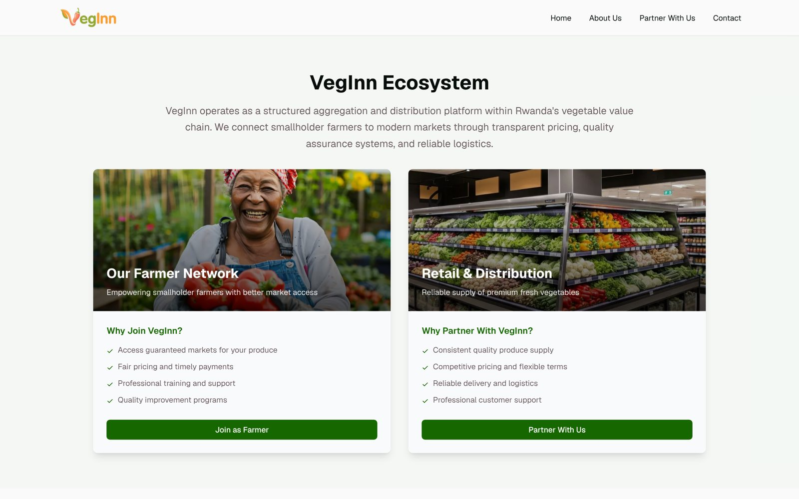
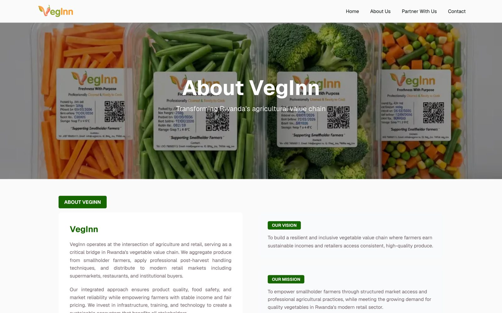
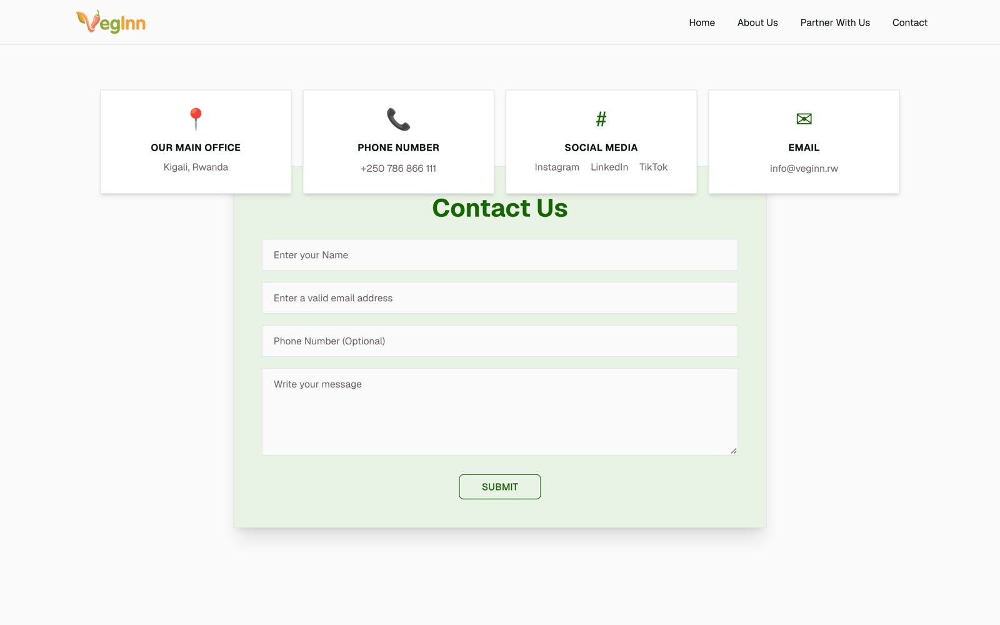
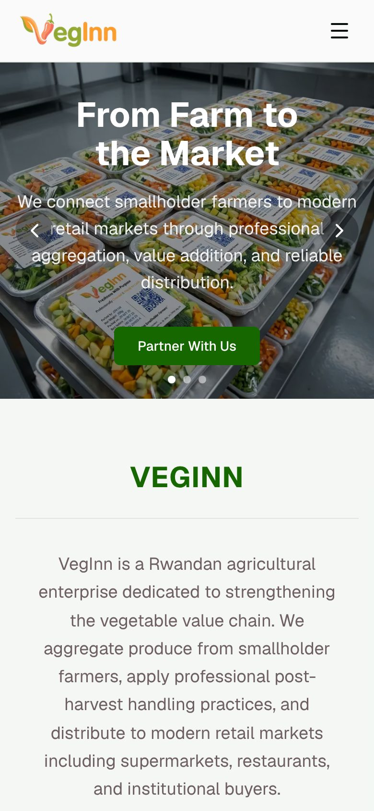

# VegInn: website for a Rwandan vegetable value-chain business

**Live site:** [veginn.rw](https://veginn.rw)

VegInn is an agribusiness I co-founded in Kigali in 2025. We buy vegetables
from smallholder farmers in Rwamagana, clean and pack them as ready-to-cook
packs, and supply supermarkets, restaurants and institutions in Kigali. This
repository is the company website. I designed, built, deployed and maintain it.



---

## Why the website exists

VegInn has two very different audiences, and the site has to work for both:

| Audience | What they need from the site |
|---|---|
| **Smallholder farmers** | Proof that VegInn is a real, reliable buyer, and a simple way to ask to join. Many browse on a basic phone with a slow connection. |
| **Retailers and institutional buyers** | Confidence in quality and consistency of supply, and a quick way to start a partnership conversation. |

So the core of the site is not the pages. It is the two forms ("Join as
Farmer" and "Partner With Us") that turn a visit into a conversation, plus
fast, mobile-first pages that load well on a weak network.

## Impact so far

These numbers are kept in one file ([`lib/impact.ts`](lib/impact.ts)) so the
site can never show two different versions of them:

- **30+** smallholder farmers supplying VegInn
- **2** districts covered
- **10+** retail and institutional buyers served

---

## Screenshots

| Partners: two audiences, two paths | About |
|---|---|
|  |  |

| Contact | Mobile |
|---|---|
|  |  |

---

## How it works

```mermaid
flowchart LR
    V[Visitor<br/>phone or laptop] --> P[Next.js pages<br/>on Vercel]
    P -->|form submit| A["API routes<br/>/api/partner · /api/contact · /api/subscribe"]
    A --> R{Rate limit<br/>5 req/min per IP}
    R -->|too many| E429[429: try again later]
    R -->|ok| Z{Validate with Zod}
    Z -->|invalid| E400[400: field-level errors<br/>shown in the form]
    Z -->|valid| S[Escape HTML,<br/>sanitise headers]
    S --> M[Resend email API]
    M --> I[(info@veginn.rw)]
```

Each form submission goes through the same steps:

1. **Rate limiting** ([`lib/rate-limit.ts`](lib/rate-limit.ts)): each visitor
   (by IP address) can send at most 5 requests per minute, which stops spam
   bots from flooding the inbox.
2. **Validation** with [Zod](https://zod.dev) (a library that checks data
   against rules): name length, email format, phone length and partner type
   are checked on the **server**, not only in the browser, because anything
   sent from a browser can be faked.
3. **Escaping** ([`lib/email.ts`](lib/email.ts)): user text is made safe
   before it goes into the HTML email, so nobody can inject links or scripts
   into the email VegInn receives.
4. **Failing clearly:** if the email service is not configured, the API
   returns a 503 with a fallback email address instead of failing silently.

## Tech stack

| Layer | Choice | Why |
|---|---|---|
| Framework | Next.js (App Router), React, TypeScript | Pages are rendered on the server, so they load fast on slow phones and are easy for search engines to read |
| Styling | Tailwind CSS, shadcn/ui (Radix) | Mobile-first layout with accessible components |
| Map | Leaflet / react-leaflet | Shows farms, packing centre and retailers without a paid map API |
| Forms and email | Zod, Resend | Server-side validation, transactional email |
| Hosting | Vercel, with Vercel Analytics | Automatic deploys from `master`, privacy-friendly traffic numbers |
| SEO | `app/sitemap.ts`, `app/robots.ts`, Open Graph metadata | So the site can be found when someone searches for Rwandan vegetable suppliers |

## Project structure

```
app/                 pages (one folder per route) and API routes
  api/               contact, partner, subscribe: server-side form handlers
components/          page sections (hero, impact stats, farmer story, map, navbar, footer)
  ui/                shared UI building blocks (shadcn/ui)
lib/                 email safety, rate limiting, impact numbers, helpers
public/              images and icons
docs/                deployment notes and screenshots
```

## Run it locally

```bash
pnpm install
cp .env.example .env.local      # add a Resend API key to test the forms
pnpm dev                        # http://localhost:3000
```

Without an API key the site still runs. The forms return a clear
"email service not configured" message instead of crashing.

```bash
pnpm build           # production build (fails on type errors, by design)
npx tsc --noEmit     # type-check only
```

Deployment, environment variables and SEO are covered in [`docs/DEPLOYMENT.md`](docs/DEPLOYMENT.md).

---

## What I learned

- **Build for the user's real conditions.** The farmers we want to reach
  mostly use phones on mobile data, so I checked every page at phone width
  first and kept images optimised.
- **Never trust the browser.** Browser-side validation is for convenience;
  the server has to check everything again. Escaping user input before it
  goes into an email is a small thing that prevents a real attack.
- **One source of truth for numbers.** Impact figures live in one file with
  a `verified` flag, so an unverified number can be previewed during
  development but never reaches the live site by accident. This is the same
  idea as a single, trusted table in a data warehouse.

## What's next

- Store form submissions in a database as well as emailing them, so VegInn
  can track farmer sign-ups and buyer leads over time.
- A simple dashboard for supply volumes and waste per harvest, using data we
  already collect on paper.
- Replace the in-memory rate limiter with a shared store (for example Redis),
  because memory is not shared between serverless instances.

## Author

**Josiane Ishimwe**, co-founder of VegInn.
[GitHub](https://github.com/Joh-Ishimwe) · [LinkedIn](https://linkedin.com/in/josiane-ishimwe)
